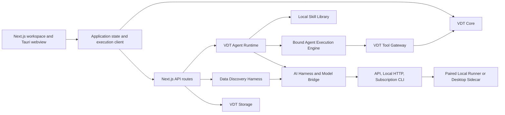

# Architecture

## Smart KPI preparation and explicit apply boundary

The formula/mixed revision uses strict `incoming_kpi_apply.v2` drafts and
`smart_kpi_operation.v2` journals. Preparation-free context/preview ports feed the
pure full-project compiler; one immutable resolved alias/formula/candidate is
saved through the existing authority. Historical v1 committing receipts replay
their exact request without new proposal validation or recompilation. See the
[incoming contract](architecture/SMART_KPI_INCOMING_CONTRACT.md).

The new-Add compiler derives bounded type-only repairs for formula-free
`calculated` nodes declared as plan inputs with no mathematical children. It
validates a virtual repaired base, appends those repairs to the same changeset
and validates the complete resulting hierarchy. Context/fingerprints and the
checkpoint remain based on the original graph. Preview never publishes repairs;
committing v1/v2 journals still replay their exact captured candidate.

`vdt-core/src/suggestions` owns strict contracts, semantic fingerprints, canonical
recipe provenance and one-layer compilation. `vdt-agent/src/smart-kpi-recipes.ts`
projects canonical blocks into browser-safe generated data; Node skill loading
never enters browser imports. The harness task and separate Smart runtime executor
make one completion. The service owns same-origin JSON/stream admission, explicit
provider selection, pinned API transport and terminal requestId cancellation.
Client, HTTP host and common runner/sidecar enforce active workspace ownership;
unknown cleanup quarantines the execution across component disposal and browser
reload for the host session. No durable agent lease/CAS authority is introduced.

Ordinary structured-agent Cancel reuses `pendingIncomingKpiRestart` as a scoped
stop marker, retaining it across errors/reload until the terminal cleanup receipt
and snapshot are confirmed. The current graph is preserved and the old run joins
the callback fence. Sequence 4 permits only the current epoch's runtime
`RUN_CANCELLED`/`cancelled` event to obtain a fresh bounded audit fence after its
ownership fence expires; it does not renew execution authority. Repair of an
already aborted controller first closes it, then verifies the same binding/epoch
before appending that terminal fact through fresh persistence. Epoch takeover,
provider restart and graph writes remain outside this repair.

`smart-kpi-cache.ts` persists only validated proposals and LRU metadata in its own
origin-local IndexedDB: 256 entries, 2 MiB and 7-day TTL. Corruption/quota errors
isolate storage and retain a bounded memory fallback; negative results use a 30 s
memory-only cooldown. Semantic context, preparation-policy version,
catalog/schema/validator and stable backend,
model, binding and credential identity key reuse; admission IDs, heads, layouts,
scenario numeric motion, raw prompts and secrets are excluded.

One workspace scheduler owns one in-flight transport/process job and queue 12,
with hover/selected/new-child/visible priority, deduplication and at most 8 automatic
provider attempts per semantic generation. Selected plus at most 6 visible old
nodes or 6 newly added immediate children can prewarm; there is no recursive tree
build. Semantic graph hashes are shared/memoized, never recomputed on hover. Frozen
list/selection and action-time revalidation APIs connect the editor to preparation.
`smart-kpi-transaction.ts` compiles one immutable candidate and checkpoint, reserves
before awaiting, reconciles ordinary pending writes, and uses ADR-004's actual
revision/runtime CAS. Only an acknowledged, still-owning exact candidate can
publish. A fresh authority read rejects superseded idempotent receipts. Unknown
outcomes (including retryable409 and uncertain503) replay the original body/key/CAS;
known policy rejects and conflicts do not become a new-head retry. An owner/VDT
marker blocks another Smart Add and automatic save of a conflicted draft until an
actual stored reload; the same-active editor shortcut cannot clear it. Undo requires exact post-apply content and authority,
then appends a new revision. The checkpoint remains in Versions.

`smart-kpi-scope.ts` derives owner/VDT and period from current root assumptions and
the stored record; absent/conflicting/custom calendar evidence is retained honestly.
Compatible per-trip formulas do not require a fabricated monthly grain.
`smart-kpi-decisions.ts` separately retains explicit canonical role decisions,
bounded to 128 entries/256 KiB UTF-8/7 days. A validated model decision or accepted
canonical parent-child role supplies Library applicability; names/tags do not.
Accepted child roles are ready before new-node publication/prefetch.

Formula-first preparation admits audited recipes or formally checked generic
definitions. Formula-null starting rows require an explicit edited formula before
Add. Existing sourced/context graphs stay readable; future accepted parents become
calculated only after the local numeric Add gate resolves every effective input
and verifies baseline equality. Missing values, a custom period or no recipe
match alone do not prevent preparation. Genuine model
empty results retain their bounded rationale and limitations through the client,
memory cooldown and escaped panel text. Provider/validation errors remain failures.
Changing preparation policy invalidates rebuildable outcomes independently of
the unchanged proposal wire schema and formula validator.

`incoming-values.ts` resolves existing materialized graph values, user numeric
text, a uniquely invertible last input and optional illustrative allocations.
The reference is the evaluated current
parent, then its retained source value, or an explicit user reference when both
are absent. It never changes known source values to fit. Add materializes finite
inputs with user/derived/assumption provenance in its existing changeset and pins the
resolution in the immutable journal. Recovery checks that resolution against
its captured base and candidate; historical committing v1/v2 bodies without
numeric evidence retain exact replay. Preview/editing invokes no model, raw-file
read or mapping refresh. New source facts are not inferred from KPI names.
Proposal-backed UI drafts enable `estimateMissingValues`; manual drafts can opt
in. Deterministic unit-aware seeds and a solved free operand provide a reconciled
illustration. `estimatedAliases` retains assumption status when estimated text is
edited; disabling estimates clears those estimated edits rather than relabelling
them as facts. Unknown parent references require explicit entry and an optional
`referenceValueEstimated` flag. Parent and input assumption metadata are validated
with the pinned resolution during recovery, alongside their numbers.

The exact committing journal is read back before a stored POST. Browser quota
failure cannot throw after in-memory publication or reclassify an acknowledged
commit as unknown. Recovered candidate/input/CAS/ownership/checkpoint disagreement
retains evidence and blocks replay. Pre-Smart historical chats remain readable;
Continue starts a fresh run with the current graph, while old queued callbacks
stay fenced. Bounded store/native source and protocol reviews passed, as did
local Chrome prepared-control, stored Add/reload/Undo and reconciliation fixtures.
Cache/scheduler have no revision authority. See
[validation and qualifications](PRODUCTION_READINESS.md#smart-kpi-validation) and
[ADR-008](adr/ADR-008-smart-kpi-preparation-and-explicit-apply.md).

Existing plans are extended atomically with the proposed graph. Inputs can own
context-kind/contextual-edge explanations while remaining factor leaves. Only
the internal incremental-user inspector purpose reports root grouping as a
construction warning. Default agent inspection/finish keep it blocking; all
other hierarchy errors remain blocking in both purposes.

Planned non-numerical reference containers are derived from the root decomposition plan and shared by calculation, runtime backlog summaries and web rendering. They require planned context children and no numeric value/formula; numeric leaves and active factors retain ordinary validation. Root reference-column grouping is an agent construction/finish policy, deliberately separate from JSON import shape validation so historical plans can still be inspected and repaired.

## Decomposition plan and branch repair

The optional `VdtNode.decompositionPlan` root metadata holds the agent-authored version-1 factor plan. It is a permitted internal node change-set field, not an unrestricted public `vdt.update_node` argument. Existing node-update preview, approval, revision-CAS, receipt, undo and snapshot paths persist it without a storage migration. Formula and visual-edge storage remain independent; the new full-tree Supervisor policy requires their declared hierarchy agreement before finish. The host validates structure and declared shared references, not domain selection or business formulas. Branch reparenting is one ordinary edge change-set transaction, with no numeric or formula rewriting. Legacy/manual project reading and arithmetic stay backward-compatible.

## Project file library

Project files are now owned by the SQLite workspace project, with explicit
many-to-many tree associations. The web **Files** tab/dialog keeps its listing and
operation state in the mounted component, reads persisted metadata through the
local file API and does not put file bytes in Zustand/localStorage. A project can
upload before its first tree exists. Builder computer/saved-source selection
retains/attaches immediately; analysis remains a separate operation.

Immutable `files/<datasetId>/{payload.bin,metadata.json}` stay in their existing
locations. Separate `display-name.json`, `archive.json` and
`vdts/<vdtId>.json` sidecars hold labels, reversible archival and attachment
availability. Each sidecar is replaced atomically through its own unique
temporary file. Independent tree associations do not share a mutable manifest.
Legacy metadata `vdtId` supplies the original association unless a sidecar
overrides availability; no SQL migration or source rewrite is needed. Listings
read metadata only. Original reads still validate full size/hash and paths.
Detached/archived originals remain readable by previously associated trees for
saved graph/run references. Attach/restore is explicit; archive is not erasure or
access revocation. Discovery projects a shared source's metadata into the actual
analysis VDT while keeping immutable source identity/hash and separate run/graph
ownership. The existing agent dataset adapter continues listing only current
attachments of its admitted VDT.

## Experimental retained-source session path (2026-10-17)

`packages/data-harness` exports the deterministic retained-source parser without invoking its semantic model loop. `packages/vdt-agent-runtime` owns the five injectable `data.*` tools and aggregation/materialization contract. The trusted-local web dataset adapter derives owner scope from the run, reads immutable retained bytes and verifies the content hash; tools receive no model-controlled filesystem path. Query writes enter the ordinary proposed mutation and revision pipeline. These observations are static; no refresh engine or executable data mapping was added.

The web host may keep an explicitly admitted OpenAI research provider in process memory for one hour. Dynamic research resolution preserves explicit environment configuration and uses the session only as an otherwise unconfigured fallback. OpenAI binding start with research enabled is the admission path; credentials are absent from durable snapshots. CLI output-schema files are private run-state artifacts removed after each completed child process.


Last reviewed against the working tree: **2026-08-26**.

## System Context



## Design Principles

- AI proposes meaning and structure; deterministic code validates and calculates.
- The user owns approval and must see assumptions, unresolved questions and material evidence.
- Provider execution is bounded by registered tasks, schemas and reviewed manifests.
- The run binds to exactly one cognitive engine/profile/backend/model/session;
  deterministic supervision and the VDT Gateway retain mutation authority.
- A qualified external agent may call only approved VDT application tools;
  external coding agents do not control the app, repository, shell,
  filesystem, database or provider settings.
- Projects, revisions, datasets and evidence require explicit ownership and immutable identities.
- Preview/sample artifacts are not calculation sources.
- Security and documentation are part of the implementation contract.

## Workspace Packages

| Package | Responsibility |
|---|---|
| `apps/web` | Next.js UI, API routes, Zustand UI/draft state and execution-client boundary |
| `apps/desktop` | Tauri shell, reviewed native commands, sidecar host and private IPC |
| `packages/vdt-core` | Graph/domain types, change sets, formula parser/evaluator, validation, scenarios, comparison and export |
| `packages/vdt-storage` | SQLite project metadata, strict atomic revision commit/recovery, production Sequence 3 plus additive Sequence 4 migration, conversations and filesystem layout |
| `packages/vdt-agent` | Current V1 skill parsing/classification/retrieval and recipe compilation; target single-copy repository contracts |
| `packages/vdt-agent-runtime` | Compatibility decision loop plus session contracts, Supervisor, VDT Gateway, Event V2 outbox, receipts, finish verification, research tools and mutation pipeline |
| `packages/data-harness` | Experimental file parsing, profiling, semantic inference, data-agent loop and mapping proposals |
| `packages/ai-harness` | Task prompts, schemas, provider abstraction, local validation and repair |
| `packages/model-bridge` | Backend registry, task/schema IDs, safe parsing, subscription adapter contracts and default-off external session-engine adapters |
| `packages/local-runner` | Loopback API, reviewed backend manifests, process isolation and desktop sidecar runtime |
| `packages/cli` | Deterministic validate/calculate/export commands and runner launcher |
| `packages/ui` | Shared UI primitives |

## Primary Runtime Flows

### Manual project flow

`UI edit -> local command/change set -> core validation/calculation -> save revision -> SQLite metadata + revision file`

W0.1 routes all production revision writers through one domain `commitVdtRevision()` boundary. It validates strict canonical payload bytes, reserves idempotency/attempt/head state under CAS, publishes a revision-ID path with `O_CREAT | O_EXCL` no-clobber semantics, fsyncs the file and directory, and only then commits the active head. Manual/create APIs and agent persistence use the same boundary; list/load responses expose persisted project runtime state and per-VDT heads.

The implementation still duplicates substantial draft/project state in Zustand persistence. W0.1 preserves unsaved local edits on conflict and blocks navigation after a failed auto-save, but SQLite-only durable ownership, metadata/revision atomicity and broader dirty-state reconciliation remain W0.5 work. Windows storage durability is not verified.

The workspace rail uses a direct Home link to `/`; the editor header's back link targets `/projects/<projectId>`. Project/editor route synchronization gives changed URL parameters precedence over the workspace snapshot. Store-driven navigation retains its target until Next.js commits the URL, and asynchronous bootstrap/VDT selection blocks reverse URL writes until it settles. An unchanged route can still reflect a newly created local VDT in `?vdt=...`.

`WorkspaceNavigationLink` intercepts normal client navigation through those two editor links and awaits the existing `saveActiveWorkspaceVdt` CAS/idempotency operation. A failure preserves the editor and displays a navigation error; a save covering an older in-flight snapshot also blocks leaving. Successful Back navigation uses the route-sync hook's explicit project intent, superseding any pending creation route. This closes the link-driven edit-loss path without adding a new revision API or changing the remaining W0.5 draft/durable-ownership boundary.

### Editor version flow

`Versions -> selected project.versions checkpoint -> deterministic base comparison / checkpointed restore -> existing draft and revision persistence`

`vdt-core` owns snapshot cloning, the 20-entry FIFO and `restoreVersionWithCheckpoint`. The restore helper resolves the original target before adding the backup so the oldest target remains restorable at capacity. Snapshot IDs include a collision-checked sequence for multiple checkpoints in one millisecond. Embedded snapshots omit nested version history before cloning.

The web store owns manual checkpoint naming, automatic readable pre-change names, revision increments, restored selection/brief reconciliation and `project_replaced` notifications to an active agent. UI presentation also translates legacy automatic labels. Restore preserves saved node positions. A non-persisted Undo record identifies the backup and restored graph/scenario/source/review references and active VDT; later model changes, missing backups or a different VDT invalidate one-click Undo. The backup itself stays in `project.versions`, including localStorage recovery and ordinary saved VDT revision payloads. This does not introduce a second revision API or close the existing W0.5 persistence/ownership gaps.

### Excel export flow

`UI Export Excel -> exportProjectExcel(project, { scenarioId: activeScenarioId }) -> Uint8Array workbook -> browser Blob download (<VDT display name>.xlsx)`

The browser calls the deterministic `vdt-core` exporter with the complete current project and selected scenario ID. The exporter creates Office Open XML sheets, styles, native border connectors, a native Source table and live formulas in memory, then packages them with `fflate`; it does not call a provider or upload the workbook. `getExcelNodeCells(project)` exposes the VDT stable node-ID-to-cell mapping, and `getExcelWorkbookCells(project, options)` exposes Source/scenario references used by formulas and tests.

Visible sheets are ordered `Scenario Mode`, `VDT`, `Source`, `Guide`, followed by hidden `_Scenario Calc`. `Source` owns editable numeric values for formula-free KPIs, with `KPI`, `Value`, `Source`, `Comment` columns. VDT Baseline formulas compare `SourceInputs[KPI]` with immutable exported human-label keys on the hidden calculation sheet. A `SUMPRODUCT` equality guard requires one matching label; `INDEX` resolves Value using row 1 for a single-row table or `MATCH(TRUE, INDEX(...,0),0)` for larger tables, without comparison-criteria or wildcard interpretation. Unique human-readable KPI labels are stable lookup keys, permitting table sorting/filtering; labels must remain unchanged.

`VDT` places parents left of children with two narrow connector columns between KPI columns. Its Potential formulas consume the same selected scenario calculation as `Scenario Mode`, including a non-main selection or scratch analysis without configured scenarios. `Scenario Mode` uses the selected scenario, or the first scenario as fallback, for totals and driver analysis. Each unconfigured Scenario value is a same-sheet reference to its Baseline cell. The calculation sheet recognizes that exact default formula on formula-bearing drivers as absence of an own override; upstream scenario inputs can therefore recalculate them. Replacing the default reference with a numeric value applies an override. Default-reference recognition uses native `FORMULATEXT` with `IFERROR` and requires Excel 2013 or later. The hidden `_Scenario Calc` sheet evaluates combined and isolated driver cases with live formulas; combined root change minus the sum of isolated effects produces the interaction residual. Scenario Mode keeps compact totals and places the Multiplicative effect label and value on one row; `Guide` holds explanations and errors.

Native conditional formats select literal-space thousands grouping by displayed magnitude without changing Excel's global separators or rounding stored values/formulas. Numeric displays use two decimals; magnitudes at least `1e48` use scientific notation. Base/Potential prefixes keep negative signs with their numbers. Percentage caches use the application's 0–100 scale with a literal percent-sign format. Source/Comment metadata does not establish external refresh connections.

Cached values come from core calculations, and workbook settings request recalculation in Excel. Collapsed/filtered canvas state does not limit export. A filename helper preserves the VDT display name except for filesystem-unsafe characters, trailing Windows dots/spaces and reserved names. A binary download helper preserves workbook bytes and revokes its Blob URL after the download click. The editor has one direct Export Excel action; editor-level JSON import and JSON/Markdown downloads have been removed. Core JSON serialization remains in use by storage and examples, and the CLI retains JSON/Markdown output. Full project archive import/export with source attachments is planned at the project-workspace level.

### Agent flow

Public legacy compatibility flow:

`POST /api/agent/runs -> first agent_decision-v2 (also supplies the first UX message) -> repeated agent_decision-v2 -> 1 tool or 2-6 sequential tools -> structured feedback -> validate/calculate -> SSE snapshot/events -> user review`

The agent runtime is a real iterative loop. A single user-selected provider/model owns the whole run. The legacy orchestrator no longer makes the independent `orchestrator_first_response` cold call; that contract remains registered for compatibility, while the first `AgentDecision.statusMessage` preserves the first visible agent reply. Batches stop on the first error, pause or approval; `deepen_node` remains a one-call, one-layer exception. Parent formulas can be proposed atomically with sibling additions, and a bottom-up formula backlog blocks ordinary finish until the graph is valid and the root calculates to a finite value. Decision context is capped at 24 priority nodes and 12 events, with node/subtree tools available for expansion. Step-limit exhaustion is a persisted `needs_user_input` pause resumed by `continue_run`, not a terminal failure. Tools are registered and Zod-validated, but the JSON Schema summaries shown to models omit types/required/enums for most tools. Restart auto-resume and complete manual-change reconciliation remain open.

Session-oriented ADR-006 foundation:

```text
UI / API
  -> VdtRunSupervisor (lifecycle, binding, checkpoint, recovery, finish)
     -> exactly one AgentExecutionEngine / AgentRunSession
     -> VdtToolGateway
        -> receipt -> allowlist/policy -> preview -> validate -> calculate -> apply
        -> vdt-core and durable project authority
```

`model_agent` uses structured turns owned by
`InProductModelAgentEngine`; `external_cli_agent` uses a qualified persistent or
checkpoint-resumed CLI session. The engine wire cannot supply run/project/actor,
permissions, revision or idempotency authority. The Gateway derives them from
the immutable server binding and serializes mutation work. At the engine port,
one initial context is followed by deltas. A persistent transport sends that
context once. The currently unqualified stateless HTTP adapter instead carries
a required server-private semantic checkpoint capped at 16 KiB, the confirmed
cursor/hashes and only the current delta; it never replays the raw project,
catalog or full transcript. That semantic checkpoint is process-private, so the
adapter advertises `supportsResume=false` until it has durable state or a
provider-native continuation. Questions, approvals and finish are durable
control checkpoints in the same logical session.

Structured Model Agent checkpoints optionally include server-owned
`modelAgentLoopState` with the consumed turn count and at most 500 hashed
tool-failure counters, each capped at three attempts. New checkpoints preserve
these limits across resume epochs; older checkpoints initialize them to zero.
The public route passes `options.maxSteps` (default 40, cap 60) to the engine.
Three repeated tool/constraint failures terminate before another inference,
preserve the draft and release the Supervisor controller. A successful call to
the same tool clears its failures; a confirmed project mutation clears failures
across tools. Unrelated reads and changing call IDs cannot reset counters.
Turn-limit exhaustion is also terminal today; structured budget continuation
remains an implementation gap. No provider fallback is introduced.

For the structured Model Agent path, the Gateway captures the server-side
builder revision. A manual edit that lands during inference makes the next
mutating or finish call fail with `STALE_REVISION`; no mutation runs, and the
same session receives a compact `manual_reconciliation` delta at a durable
checkpoint. Approved proposals also recheck their base revision before apply.
Their server-only apply is serialized with model tools, reserves a Sequence 4
receipt before mutation and replays the terminal result by stable proposal and
selection identity. This is still not the complete ADR-005 cross-process
ownership/merge coordinator.

The working tree implements the engine ports, Supervisor, Gateway, compact
execution projection, receipt/checkpoint schemas, Event V2 hash chain,
deterministic finish verifier and a default-off Cursor ACP canary. A registered
server-owned structured Model Agent binding now instantiates this stack through
the public start/message/cancel/SSE routes. Its server-owned definition is
registered but disabled and omitted from discovery unless
`VDT_MODEL_AGENT_ENABLED=true`; the legacy provider-ID loop requires its own
explicit production compatibility flag, and there is no automatic
profile/backend fallback. Cursor has no accepted hard-isolation qualification.
The trusted-local development launchers explicitly enable unverified CLI
checkpoint sessions. Codex adds immutable model-specific binding IDs, derived
from a SHA-256 model identity, only for validated IDs returned by its
authenticated host CLI catalog. The browser selects an existing binding and
checks its backend/model before enabling Send. Production still rejects the
canary; failed catalog discovery retains only the host default until restart.
When the AgentRunStore is SQLite-backed, the route uses the
normalized Sequence 4 tables as primary Supervisor authority and the V1 run row
as a secondary projection; an Event V2 commit remains authoritative if that V1
projection temporarily fails, and the projection is deterministically caught
up from the V2 chain. Pre-provider `in_flight` exchange state is durable.
Restart auto-resume remains fail-closed as `recovery_required`; a recovery
coordinator does not yet reconstruct the builder or restore paused
interactions. The Supervisor can hydrate and finalize a verified finish receipt
only under the exact successor recovery epoch, but no public coordinator invokes
that path automatically.

`vdt.instantiate_subtree` deterministically clones a validated subtree,
remapping its IDs and internal formula references. Enum mismatch diagnostics
and numeric comma parsing are local deterministic domain behavior, not model
repair heuristics.

The current skill path classifies requests and can select a generic fallback; `skill.read` also changes selection state. Those are V1 limitations, not the target contract.

### Corrective V2 boundary (target, default-off)

[`ADR-003`](adr/ADR-003-single-copy-skills-and-agent-owned-resolution.md) defines the frozen boundary; the exact design-only fields, canonical byte framing and state transitions are in [`CORRECTIVE_GATE_A_CONTRACT_SCHEMAS.md`](architecture/CORRECTIVE_GATE_A_CONTRACT_SCHEMAS.md).

```text
original user request
  -> agent catalog browse/discovery
  -> read exact accessible skill versions
  -> explicit skill.select under run-state CAS
  -> pinned recipe bindings
  -> one validated immutable RunBuildBasis
  -> ChangeSet / validation / approval
  -> atomic revision commit
```

Bundled skills retain one reviewed canonical source under `packages/vdt-agent/skills`; sidecar files remain generated. User skill versions are stored verbatim once and shared by ACL reference rather than content copies. Retrieval/indexing is recall-only and cannot mutate selection. There are no translated variants, language alias registries, marker-selected skills or automatic generic fallback in the V2 contract.

Repository and write commands receive a server-issued actor context. Client/model payloads cannot choose principal, tenant/workspace/project ownership or a human approval actor.

All V2 feature flags are server-owned, fail closed and default to disabled. Projects receive sticky runtime-generation/migration state before any V2 writer can be enabled. V1/V2 mixed writes and destructive down-migration are prohibited.

### Data discovery flow

`selected KPI From file / composer paperclip -> scoped POST /api/data/files or retained-source list -> project-owned immutable bytes -> POST /api/data/discovery/runs -> full-byte parse/profile -> configured-provider semantic suggestions -> required structured decisions -> full-byte deterministic hierarchy rerun -> source/target/coverage validation -> normal VDT change-set preview`

This separate experimental local harness accepts provider-assisted table/category/additive-value suggestions through `createManagedAwareAiProvider`. The deterministic incoming compiler supports complete additive hierarchies (up to four category levels and 200 nodes) from numeric values in confirmed target-compatible units, direct durations or explicit start/end timestamps, and confirmed total/per-day normalization. A declared reporting period describes the full source extract/denominator; it is not a row-filter query. All required mapping and provider clarification questions remain apply blockers. Structured edits reload immutable full bytes; final staging reruns against the server-retained initial project basis after validating the client's current semantic target and immediate children. Each generated KPI Description carries source hash/reference, table, columns, filters, calculation, reporting period and row coverage. The core calculator consumes materialized Baselines and parent sum formulas; it does not execute or refresh `dataMapping`.

Upload/list/download/library-edit/run routes require trusted local app mode and strict IDs. File operations require a real SQLite project and validate any supplied tree's `vdt.projectId`; analysis/run operations require the actual tree as well. VDT reads require a current or historical explicit association; project library reads can open any source owned by that project. `VdtProject.id` is the original graph snapshot identity; it may differ from both the SQLite workspace owner and selected VDT record ID. The selected VDT's stored active revision supplies the expected graph identity for request validation. Imported graph IDs are preserved without rewrites or migrations. Sources are write-once at `projectDir(database.dataDir, projectId)/files/<datasetId>/`, with original name metadata, exact bytes and checked SHA-256/size. Runs retain file ownership plus explicit `workspaceProjectId`/`vdtId` and a separate initial project context. File/run reads use persistent storage instead of trusting an in-memory cache; scope mismatches, unsafe IDs and symlink paths fail closed. Old global `data-discovery` records are retained for trusted-local compatibility and never used as scoped fallbacks. Browser discard leaves source files intact. Hosted multi-user authorization, parser isolation, permanent retention/erasure, encryption and general refresh remain open. See `DATA_INGESTION.md`.

### Model execution flow

The browser-side `apps/web/lib/ai-execution-client.ts` selects one of:

- hosted API/BYOK route;
- development standalone runner;
- reviewed Tauri command IPC in desktop mode.

`packages/model-bridge` owns backend IDs and schema IDs. `packages/local-runner` owns executable aliases, static arguments, environment, timeouts and output caps. Browser requests cannot provide executable details.

Model discovery follows the same ownership boundary. Subscription model IDs come only from adapter-owned CLI commands. BYOK Settings sends `operation: list_models` plus the resolved in-memory provider configuration to `/api/ai/generate-vdt`; the server performs the bounded provider request and returns normalized IDs. The browser never calls provider model endpoints directly, and static preset/CLI catalogs are not treated as availability evidence. Azure uses a manual deployment name because the resource model catalog is not a deployment inventory.

Execution mode UI categories are `cli_subscriptions`, `local_models` and `byok`; the internal execution contract stays `local_cli`/`byok`. The category follows the effective runner/backend rather than a stale selected CLI ID. `executionSettings.savedLocalModelSelection` stores the last local HTTP preset/model across category switches; local-server changes use server-specific defaults. Background CLI scans may refresh detection while another category is active, but cannot normalize its execution selection. Memory overrides are independent and tab switches do not clear them.

## Data And State Ownership

Local voice input is independent from chat model execution. An AudioWorklet sends bounded PCM snapshots through same-origin localhost development routes or the reviewed desktop `speech_request` → `speech` private-pipe method. The local speech runtime owns the fixed download catalog, integrity checks, model directory and short inference jobs; the UI owns provisional text and preserves manual Send. Persistent model weights are application-local, preferences browser-local and temporary WAVs job-owned. Details and remaining qualification limits are in [VOICE_INPUT.md](VOICE_INPUT.md).

| State | Current owner | Target rule |
|---|---|---|
| UI preferences and recoverable draft | Zustand/localStorage | Remain browser-local and non-authoritative |
| Projects and VDT metadata | SQLite | Durable source of truth |
| VDT graph revisions | Strict canonical revision files + SQLite head/attempt/idempotency state | W0.1 atomic revision-CAS writes implemented; Windows durability unverified |
| Agent runs | SQLite-backed stores: normalized Sequence 4 primary authority plus secondary V1 projection; non-SQLite test stores remain injected | Complete restart coordinator over the same binding, bounded exchange/tool/checkpoint attempts, Event V2 outbox and recovery |
| Uploaded datasets | Project `files/<datasetId>` immutable sources with library/association sidecars and project-scoped discovery snapshots; legacy global records retained | Authenticated hosted ownership, permanent retention/erasure, encryption and reusable execution |
| Skills | `packages/vdt-agent/skills` for current bundled source | Single-copy repository: reviewed bundled source plus immutable verbatim user versions; ACL references; generated sidecar only |
| Provider status | `release/provider-certification.json` | Canonical release metadata |

Subscription visibility is a browser-local Zustand preference (`removedCliAgentIds`), persisted separately from runtime detection. Hydration accepts only known provider IDs, clears any removed chat/memory selection, and does not treat legacy command fields as an active provider. Rescans retain removal preferences and exclude removed providers from automatic selection. A removal may use a remaining live `ready` CLI as a deterministic chat fallback, with visible feedback; without one, the selection is cleared and request readiness blocks execution. It never changes vendor credentials or installed software. Test/auth results and busy flags remain session-only; duplicate actions are guarded. Full and targeted scans serialize; callers sharing a scan await its completion. Test and managed sign-in request a fresh post-action scan, and per-provider revisions prevent older scans/tests from restoring readiness after a failed Test or removal/add-back. Test immediately invalidates prior executable readiness, and success requires a fresh ready result.

### Sequence 3 runtime artifact policy

Production migration admission verifies the frozen V2 manifest, Sequence 3
SQL, WASM module, ABI contract, static WASM profile and closed transform
identity. It validates the golden-vector length/checksum from the trusted
manifest against compiled constants, but does not open, parse or execute the
121,310,783-byte vector registry. The 55 ABI and 204 host vectors remain
explicit offline certification evidence. Actual legacy `agent_runs` rows are
validated and transformed inside the fenced Sequence 3 transaction.

### Sequence 4 bounded-execution schema

After the independently completed Sequence 3 attempt, production migration
admission runs a separate Sequence 4 attempt. Its seven append-only authority
tables cover immutable bindings, monotonic session epochs, checkpoints,
exchange/tool/finish receipts and the Event V2 outbox. SQL triggers require the
exact current epoch, contiguous receipt transitions and the exact event
sequence/predecessor hash; External bindings require qualified hard-isolation
evidence. For a SQLite-backed AgentRunStore, the public Supervisor route writes
all seven normalized tables as primary authority. It derives the authoritative
project ID from `agent_runs`, exposes the effective current epoch rather than the
original binding epoch. Each write records a fresh 30-second audit fence and
tool-call reservation is atomic, but the ADR-005 shared lease with heartbeat
and takeover is not implemented. Failure to open or use this authority fails
closed; there is no silent fallback to JSON persistence. V1 runs remain readable through a secondary
projection. Unverified External canaries never write Sequence 4; spawn, segment
and logical-session counters live on the V1 `performanceTelemetry` sibling, not
on `AgentExecutionSummaryV2`. Restart recovery is still fail-closed because the auto-resume
coordinator and state rehydration described below are not implemented.

## Trust Boundaries

- Hosted web must not execute local CLIs.
- Desktop exposes only reviewed Tauri commands and private pipe messages.
- Standalone runner is loopback-only and paired.
- CLI manifests own commands/arguments/environment; provider output is untrusted.
- An External profile is unavailable unless the exact adapter/backend/CLI,
  protocol, tool-catalog hash, platform and isolation evidence are qualified.
- External engine processes use a private empty workspace and a per-run VDT
  transport only. Shell, filesystem, Git, WebFetch, foreign MCP, project
  instructions and subagents are security-boundary breaches.
- Web search results and uploaded file contents are untrusted data, not instructions.
- Local source ownership and strict path checks are implemented for scoped uploads; parser isolation, hosted authorization and dependency vulnerabilities still block production data use.

Trusted-local web/desktop hosts admit immutable Ollama/LM Studio/vLLM Model Agent bindings from their fixed-endpoint server catalogs (up to 100 valid model IDs per backend, plus the equivalent untagged alias for an installed Ollama :latest model). Catalogs refresh at most once per ten seconds on binding requests, including after an empty catalog or installation. Hosted mode, production-build evaluation and VDT_LOCAL_MODEL_AGENT_ENABLED=false disable this admission. Browser Settings cannot provision bindings. Starts require an exact backend/model match and use the existing Supervisor/Gateway without a runner/API/default fallback. Native packaging, model quality and performance remain unqualified; provider certification is unchanged.

The model-facing tool catalog preserves actual Zod parameter types, enums and required fields (nested cards bounded to three object levels, catalog below 35,000 characters). Local transports retain the immutable initial brief/catalog and only the last confirmed reply alongside each semantic-checkpoint delta; context is isolated per run. Local structured turns use manifest-owned loopback endpoints without inherited cloud credentials or redirects. Ollama uses native `/api/chat`, direct structured actions (`think=false`), model sampling defaults unless the binding overrides temperature, a 16,384-token context and JSON-schema constrained output; the Model Agent requests at most 4,096 predicted tokens for JSON, three calls and 512 characters of semantic state. Thinking frames are never interpreted as actions. Its compact native-only system instructions avoid repeating the full canonical response schema. All tool names and purposes remain visible; introspection, finish and basic structural/update schemas are upfront, and read-only `tools.describe` retrieves full schemas for 1–6 selected public tools. Hidden tools and draft replacement in continuation mode cannot be admitted. Project inspection results use transport-only columns/rows preserving all returned fields, zeroes, formulas and truncation; canonical Gateway hashes and receipts are unchanged. The Gateway remains authoritative for schema validation, provenance, scope, approvals and mutations. No models are downloaded automatically.

## Known Architectural Gaps

1. The structured Model Agent binding path is wired through public run routes,
   but its default server binding is disabled and undiscoverable until explicit
   opt-in. SQLite-backed stores use normalized
   Sequence 4 authority and bounded attempt fences, while the restart
   coordinator still cannot reconstruct builder revision, restore a paused
   question/approval or safely auto-resume. The Supervisor can hydrate a
   verified finish receipt and finalize it across only the exact successor
   recovery epoch, but no public process-loss coordinator invokes that path. The legacy
   compatibility runtime can still race with concurrent attempts/manual
   changes. The structured path rejects stale mutating calls and approved
   proposals, but complete multi-operation W0.2 coordination and merge remain
   open.
2. Visual edges, formula dependencies and units are not yet one validated contract.
3. Research lacks source opening, immutable evidence and benchmark applicability.
4. Data mappings remain declarative metadata rather than reusable executable query plans; only the bounded incoming additive-sum hierarchy materializes values during full-source analysis and review reruns.
5. Data-agent and VDT-agent orchestration are separate and inconsistent.
6. Large `vdt-store.ts` and `data-harness/src/index.ts` modules mix too many responsibilities.
7. There is no server-issued actor/tenant/workspace authorization context for the data/skill target model.
8. Sequence 3 is production-wired locally, but Windows durability, native crash evidence and package transport remain unverified release gates.
9. Real Windows Node 24 capability, concurrency and crash-recovery evidence is absent for the W0.1 durability claim.
10. Cursor ACP remains default-off and unverified. Codex checkpoint/resume has
    executable trusted-local wiring and a selected-model connection check;
    full VDT, adversarial isolation and cold/warm benchmark qualification remain
    incomplete. Claude qualification claims are unchanged.

The active remediation sequence is maintained in `VDT_STUDIO_CORRECTIVE_IMPLEMENTATION_PLAN.md`; evidence is appended to `implementation/VDT_CORRECTIVE_EXECUTION_LOG.md`. Architectural decisions are recorded under `docs/adr/`.

Local Model Agent transport now supplies a bounded read-only working graph on every turn (`hostObservation`, up to 80 nodes, revision and calculation diagnostics). This is derived from the current builder and cannot write the graph; canonical tool receipts and revision fencing remain authoritative. Ollama uses bounded NDJSON streaming (300-second first frame, 60-second idle, 480-second total, 1 MB maximum), not a single five-minute response deadline. Native tool schemas outside the core update/introspection/finish set become callable after public introspection; draft creation stays excluded in continuation runs. Checkpoints optionally retain repeated successful-operation counters; four identical operations without a project mutation stop with `MODEL_NO_PROGRESS`. Restart a development server after checkpoint-schema changes: HMR can retain old singleton validators.

`vdt.fill_input_values_batch` is a bounded existing-leaf write surface (1–8 values). It validates every target, duplicate, provenance and value before constructing one combined ChangeSet through the existing mutation/CAS pipeline. Formula and structural fields are absent. Driver creation checks normalized candidate IDs before the builder can assign an automatic suffix, so attempting to fill a known ID through add no longer creates an unnoticed copy.

Native construction also receives literal numeric excerpts from the immutable prompt/business context. These can constrain user-source claims during decoding without assigning a metric or selecting a value; later human input relaxes that initial-source constraint, and canonical Gateway validation still applies. A calculable new tree receives a fresh original-brief review and a read-only root-dependency projection before finish. Tool failures with the same non-schema result code share a retry budget across argument changes.

Local native tool availability is grounded in the current server observation: value/formula writes are withheld while a new placeholder still needs real structure. Existing-target arguments use current node-ID enums only when the graph view is complete; truncated views are not treated as exhaustive. `vdt.fill_input_values_batch` is restricted to currently unpopulated leaves and becomes unavailable when none remain, preventing repeated successful refill operations. Intentional corrections use `vdt.update_node`. The Gateway continues to validate every call against the actual fenced revision. A server-derived finish requirement rejects `ROOT_NOT_DERIVED` for a new tree represented by a standalone constant or root without driver references.

For new-tree construction, native eligibility follows read-only server diagnostics: the placeholder requires structure before value/formula updates; bootstrap tools are withheld after structure exists; standalone validation/calculation and finish are withheld until validation succeeds and the root has a finite result derived from real drivers. Every mutation still validates normally and diagnostics remain in `hostObservation` throughout construction. Existing-tree review is not forced through this construction sequence. This limits empty-root checking loops without choosing a domain, recipe, formula or estimate for the model. The native system prompt is compact; non-core catalog cards preserve names/purposes with full schemas available through introspection.

The native local transport retains bounded read evidence across semantic deltas: confirmed tool argument schemas, discovered skill IDs/titles and the latest bounded skill excerpt. Rendered `confirmedKnowledge` is capped at 10,000 characters with omissions/truncation explicit; it is isolated per provider/run and does not write graph state, select skills or alter canonical receipts. Only successful/replayed, admitted Gateway results can populate it. Skill discovery/read/compile and schema introspection run in singleton native batches so dependent IDs can be observed before use. This prevents forgetting exact schemas and skill IDs after an unrelated tool result; restart auto-resume and cross-process hydration remain unqualified.

Native new-tree creation presents bounded structural-only arguments: model-authored lowercase IDs, at most four nodes per singleton batch and short metadata. Separate existing-input and formula tools remain model controlled; no business formulas or values are synthesized by the transport. Literal source projections are marked truncated and cease to constrain decoding when incomplete.

Native Ollama construction of a new blank tree now requires a successful model-selected skill read before structural tools unlock. Confirmed failure output cannot satisfy that gate. List/search/read schemas are upfront; the initial native phase offers discovery, then a read constrained to actual returned skill IDs, before introspection/construction unlocks. The model still chooses the search and skill. A sibling batch uses per-parent schema alternatives when the working graph view is complete: the model chooses the parent, but every item must use that same ID. Truncated graph views retain canonical scope checks without claiming an exhaustive parent list. A bounded read-only calculationAssumptions projection retains up to eight calculated/root nodes, two notes of 160 characters each, with explicit truncation; it neither supplies new facts nor chooses formulas.

Initial goal clarification remains available. After discovery begins in a new blank tree, native questions wait until the chosen skill is actually read; planning the decomposition stays the model's responsibility. A final action is available only after an admitted successful/replayed finish receipt with a valid hash. That receipt fixes the native final ID and closes tool choices; new human work, stale-revision feedback or a committed graph mutation invalidates the native receipt projection. Canonical Supervisor verification remains authoritative.

For a fully visible new-tree input set, native Ollama numeric batches use a values object keyed by model-selected input IDs from one bounded page (up to eight keys). This prevents repeated targets in a generated batch. A pure wire decoder restores the canonical values array in stable ID order before engine/Gateway validation; it preserves every selected target, value, provenance and note, performs no arithmetic and changes no formulas. Other tools, existing-tree/partial-view fallbacks, canonical API arguments, receipts and approval/scope/revision checks retain their contracts.

The experimental local Model Agent can explicitly select `skill.seed_topology` after reading a skill with a complete `vdt-topology` block. The canonical English artifact owns the declarative formulas; the host does not select a domain or skill from keywords. The actor selects the skill and each illustrative reference estimate with `defaults:{inputId:true}`. Defaults require `continueWithAssumptions=true`, remain editable `default_assumption` values, and are never user facts or verified benchmarks. Unselected inputs stay unknown. The tool accepts only a blank root with a matching unit/period, validates bounded IDs, parents, formula references/cycles and root dependency coverage, and proposes one atomic mutation through the existing approval/CAS pipeline. Its skill-defined depth exception never bypasses selected-node decomposition scope. Existing work cannot be overwritten.

`mining.load_and_haul` supplies an annual joint excavation/truck-haulage topology: both fleet counts, separate annual repair/shift/unplanned losses, bucket loading productivity, payload-dependent loading time, loaded and empty travel over one route, dumping/positioning/queue time, and the minimum of both capacities. It is a steady-state draft model with continuous equivalent bucket loading, not dispatch simulation. Its numeric reference values are illustrative estimates accepted explicitly by the actor. Site fleet counts, distance, both speeds and truck planned repair have no reference defaults. Formula and sensitivity unit tests do not certify arbitrary model-authored trees or production readiness.

Native transport retains all tool names/purposes and the immutable catalog hash while avoiding a second textual copy of schemas already enforced by `format`. Original literal quantities are sent once in the current observation. The semantic checkpoint allows 512 characters. Construction search asks for 3–6 candidates; additional unread discovered skills can be read before building so the actor can cover a broader process scope. Complete topology/default choices are constrained to successful public skill-read evidence; generic builder tools remain available. Canonical tool arguments, provenance, receipts, approval and scope authority are unchanged.

The direct OpenAI client flow has an explicit admission boundary before the public start: `prepareOpenAiAgentBinding` sends the current session key/model/output limit to `POST /api/agent/bindings/openai`, receives an opaque one-use binding, and passes only its ID to `/api/agent/runs`. Trusted-local/same-origin and production host gates, an 8 KiB body bound and a fixed official endpoint constrain admission. The server registrar holds at most 16 pending immutable definitions for 60 seconds; discovery hides these IDs and start unregisters the consumed definition after resolving its private execution copy. No API key is persisted in the VDT, run, session metadata or ordinary frontend preferences. The separate browser vault restores BYOK keys across sessions using the endpoint-scoped encrypted storage and lifecycle in [ADR-007](adr/ADR-007-encrypted-browser-api-keys.md). Other gateways retain their existing explicit host binding path and cannot silently use OpenAI.

The OpenAI adapter preserves the initial context and last confirmed action for agent turns, while the Supervisor adds bounded current-graph/admitted-read observations. Its wire JSON Schema accompanies the runtime Zod validator and remains available in JSON fallback prompts. Known reasoning model families use completion-token limits and provider-default sampling. This is stateless HTTP replay, not native session continuation or crash recovery; see [live evidence](AI_HARNESS.md#openai-api-model-agent-evidence-2026-10-17).
